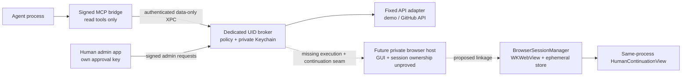

# Agent Vault browser production grounding

Read-only investigation on 13 October 2026. Source tree: `<repo>`; code checkpoint `425c6afd48b192551e19a9289f86db8c8e298da7`; current documentation checkpoint `7e255123ea675016ccc0bc4e27c51d4ecda0f7f7`. No builds, credentials, installed services, key creation, repository edits, installation or external contacts were used. This file is the investigation artifact, not a production completion claim.

## Overview

Agent Vault separates an agent-facing MCP bridge, a private policy/credential broker and a human administration app. The broker is intended to run as `_agentvault`, distinct from the UID running the bridge and app. It reserves call budgets, loads private credentials only after authorization and suppresses output if authority changes during an operation. The app can administer policy only through a fresh signed challenge. The bridge receives fixed typed results. These ownership rules are explicit in the [implementation contract](https://github.com/Fannolo/agent-vault/blob/425c6afd48b192551e19a9289f86db8c8e298da7/docs/contracts/FULL-PLAN.md#L3-L27) and [threat model](https://github.com/Fannolo/agent-vault/blob/425c6afd48b192551e19a9289f86db8c8e298da7/docs/THREAT-MODEL.md#L8-L28).

The browser component is a separate, real WebKit library with synthetic hostile-site verification. It is not connected to production execution. The deployment doc explicitly identifies the reason: its `HumanContinuationView` is a same-process AppKit view, while the dedicated-UID system LaunchDaemon has no GUI login session and the current XPC carries data only. A working production browser must close this deployment gap while preserving private session ownership. Enabling the service enum alone does not do that. [Deployment boundary](https://github.com/Fannolo/agent-vault/blob/425c6afd48b192551e19a9289f86db8c8e298da7/docs/BROWSER-DEPLOYMENT.md#L3-L40)

## Key Concepts

| Concept | Current owner and role |
|---|---|
| `Broker` | Actor owning live authorization, credential lifecycle and pending approval state. It delegates execution only after reserving a permitted attempt. |
| `ServiceAdapter` / `SessionServiceAdapter` | Core execution seam. The latter receives **grant UUID** as `sessionID`, plus grant expiry, and supports invalidation. There is no browser continuation method. |
| `PendingInvocation` | Persistent approval request bound to client, account, action and grant. Its states are `waiting`, `approved`, `consumed`, `cancelled`; it expires within 120 seconds. It is not a browser session. |
| `BrowserSessionManager` | `@MainActor` library manager with contexts keyed by **account UUID**. Runs fixed login/profile workflows, classifies human steps and destroys sessions on completion/failure/revoke. |
| `BrowserContext` | One nonpersistent `WKWebsiteDataStore`, web view, navigation gate and human-pause timer. Browser storage is never exported by its public API. |
| `HumanContinuationView` | An `NSView` containing the exact existing paused web view and Continue/Cancel buttons. Its callbacks must be wired by the host. It is not an RPC payload or remote view transport. |
| `BrowserPolicy` / `FixedRecipes` | Compiled origin allowlist, paths and selectors; the only production page-script choke point uses constant bodies and typed arguments. |
| `Contracts` / `IPC` | Data-only, exact-shape DTOs and separate authenticated read/admin XPC services. Caller arguments do not choose an identity. |

Sources: [Core domain](https://github.com/Fannolo/agent-vault/blob/425c6afd48b192551e19a9289f86db8c8e298da7/Sources/AgentVaultCore/Domain.swift#L101-L189), [session manager](https://github.com/Fannolo/agent-vault/blob/425c6afd48b192551e19a9289f86db8c8e298da7/Sources/AgentVaultBrowser/BrowserSessionManager.swift#L5-L72), [context](https://github.com/Fannolo/agent-vault/blob/425c6afd48b192551e19a9289f86db8c8e298da7/Sources/AgentVaultBrowser/BrowserContext.swift#L23-L79), [human view](https://github.com/Fannolo/agent-vault/blob/425c6afd48b192551e19a9289f86db8c8e298da7/Sources/AgentVaultBrowser/HumanContinuationView.swift#L4-L45), [contracts](https://github.com/Fannolo/agent-vault/blob/425c6afd48b192551e19a9289f86db8c8e298da7/Sources/AgentVaultContracts/Contracts.swift#L80-L148).

## How It Works

### The production path that exists

The bridge exposes `accounts_list`, `action_run`, `request_resume` and `request_cancel`. Inputs have exact keys, account/action/request identifiers and closed action types. `VaultReadClient` authenticates a broker with a payload-free probe before transmitting data. Production connections use the system bootstrap domain; every reply checks the broker UID as well as its signing requirement. The server binds a kernel UID to the connection and gives read and administration independent capacity. [Bridge](https://github.com/Fannolo/agent-vault/blob/425c6afd48b192551e19a9289f86db8c8e298da7/Sources/AgentVaultMCPBridge/BridgeServer.swift#L18-L65), [client](https://github.com/Fannolo/agent-vault/blob/425c6afd48b192551e19a9289f86db8c8e298da7/Sources/AgentVaultIPC/VaultXPCClients.swift#L95-L198), [server](https://github.com/Fannolo/agent-vault/blob/425c6afd48b192551e19a9289f86db8c8e298da7/Sources/AgentVaultIPC/VaultXPCServer.swift#L42-L91).

`ReadOperations` obtains the registered principal from that UID. A run with per-call approval creates or reuses a pending invocation and returns its opaque ID. The human app's Requests screen sends `approveInvocation` through `begin → verify local metadata digest → fresh protected-key signature → authorize`; the broker changes the pending status to approved. The agent then resumes the approved request. The human app never dispatches the service read itself. [Read mapping](https://github.com/Fannolo/agent-vault/blob/425c6afd48b192551e19a9289f86db8c8e298da7/Sources/AgentVaultCore/Administration.swift#L131-L163), [pending flow](https://github.com/Fannolo/agent-vault/blob/425c6afd48b192551e19a9289f86db8c8e298da7/Sources/AgentVaultCore/Broker.swift#L117-L190), [app authorization](https://github.com/Fannolo/agent-vault/blob/425c6afd48b192551e19a9289f86db8c8e298da7/Sources/AgentVaultAppSupport/AdminAuthorizationService.swift#L34-L53), [Requests UI](https://github.com/Fannolo/agent-vault/blob/425c6afd48b192551e19a9289f86db8c8e298da7/Sources/AgentVaultAppSupport/Views/RequestsView.swift#L9-L26).

Before execution, Core consumes an approved invocation and increments its grant's attempted-call count transactionally. After potentially blocking credential access it rechecks the client and grant, delegates to the configured adapter, then checks authority again before returning. Revocation invalidates a session adapter by grant UUID. Rotation/deletion cancel pending approvals, revoke grants and invalidate associated sessions. Failed final-policy reads also invalidate the adapter session. [Dispatch](https://github.com/Fannolo/agent-vault/blob/425c6afd48b192551e19a9289f86db8c8e298da7/Sources/AgentVaultCore/Broker.swift#L192-L255), [revocation](https://github.com/Fannolo/agent-vault/blob/425c6afd48b192551e19a9289f86db8c8e298da7/Sources/AgentVaultCore/Broker.swift#L72-L102), [lifecycle](https://github.com/Fannolo/agent-vault/blob/425c6afd48b192551e19a9289f86db8c8e298da7/Sources/AgentVaultCore/Broker.swift#L266-L325).

The daemon composes `Broker` with its default `FixedServiceAdapter` and admin `allowedServices: [.demo, .github]`. That adapter rejects browser services. The package graph does not link Browser into BrokerDaemon or App; the app's production features reject browser enrollment. These are independent disabled seams, not a hidden browser feature waiting for a UI switch. [Daemon composition](https://github.com/Fannolo/agent-vault/blob/425c6afd48b192551e19a9289f86db8c8e298da7/Sources/AgentVaultBrokerDaemon/BrokerMain.swift#L17-L27), [adapter](https://github.com/Fannolo/agent-vault/blob/425c6afd48b192551e19a9289f86db8c8e298da7/Sources/AgentVaultCore/GitHubAdapter.swift#L3-L16), [graph](https://github.com/Fannolo/agent-vault/blob/425c6afd48b192551e19a9289f86db8c8e298da7/Package.swift#L20-L45), [app features](https://github.com/Fannolo/agent-vault/blob/425c6afd48b192551e19a9289f86db8c8e298da7/Sources/AgentVaultAppSupport/AdminPlans.swift#L112-L122).

### The browser library path that exists

The manager validates a fixed workflow and username/LF/password credential (maximum 4096 bytes), rejects an existing context for the account, and creates a private, nonpersistent data store. A revocation epoch prevents a context under construction from surviving a concurrent revoke. It compiles a default-block content rule list, permits fixed asset origins, disables inspection/popups and attaches navigation/UI delegates. [Credential format](https://github.com/Fannolo/agent-vault/blob/425c6afd48b192551e19a9289f86db8c8e298da7/Sources/AgentVaultBrowser/BrowserTypes.swift#L81-L99), [manager run](https://github.com/Fannolo/agent-vault/blob/425c6afd48b192551e19a9289f86db8c8e298da7/Sources/AgentVaultBrowser/BrowserSessionManager.swift#L27-L43), [context setup](https://github.com/Fannolo/agent-vault/blob/425c6afd48b192551e19a9289f86db8c8e298da7/Sources/AgentVaultBrowser/BrowserContext.swift#L45-L74).

It loads only the policy's login path, settles briefly, validates the exact origin and one known POST form, then fills exactly one username and password field. Constant recipes run in a private content world, take values as typed JavaScript arguments and use DOM prototype methods to resist clobbering. Navigation actions/responses, redirects, hostile frames, popups and downloads fail closed; prompts, file panels and media permissions are denied. [Login recipe](https://github.com/Fannolo/agent-vault/blob/425c6afd48b192551e19a9289f86db8c8e298da7/Sources/AgentVaultBrowser/FixedRecipes.swift#L4-L55), [navigation/UI policy](https://github.com/Fannolo/agent-vault/blob/425c6afd48b192551e19a9289f86db8c8e298da7/Sources/AgentVaultBrowser/BrowserContext.swift#L155-L235).

After submission it classifies a known MFA path or CAPTCHA selector, rejected login form, or validated profile metadata. A profile or failure destroys the context immediately. Only a human-step outcome retains it, with a 600-second production pause timer. A same-process host can obtain `HumanContinuationView`, let a person act, and call `continueAfterHuman`; early continuation reports the same pending step. The library does not automate or bypass that step. Revocation destroys the view and data store. [Classification and teardown](https://github.com/Fannolo/agent-vault/blob/425c6afd48b192551e19a9289f86db8c8e298da7/Sources/AgentVaultBrowser/BrowserSessionManager.swift#L46-L72), [conclusion](https://github.com/Fannolo/agent-vault/blob/425c6afd48b192551e19a9289f86db8c8e298da7/Sources/AgentVaultBrowser/BrowserSessionManager.swift#L109-L137), [timeouts](https://github.com/Fannolo/agent-vault/blob/425c6afd48b192551e19a9289f86db8c8e298da7/Sources/AgentVaultBrowser/BrowserTypes.swift#L67-L78), [fixture checks](https://github.com/Fannolo/agent-vault/blob/425c6afd48b192551e19a9289f86db8c8e298da7/Tests/AgentVaultBrowserTests/BrowserWorkflowTests.swift#L116-L203).

Dashed edges are required future work, not existing runtime behavior.

### Work needed to connect real browser outcomes

1. **Prove the GUI/process ownership topology before wiring credentials.** The deployment note sketches a separately signed per-user GUI host, but specifies no concrete UID/bootstrap/WindowServer arrangement, process-memory boundary or installed lifecycle. A host running as the shell-capable agent's UID would not by itself preserve the intended separate-UID credential/session isolation. This is a planning inference from the existing ownership requirement; it is not a proven macOS hosting solution. Keep the broker's private credential store and broker-controlled session authority. The human view must be hosted without granting the agent cookie/profile/process-memory access. [Deployment proposal](https://github.com/Fannolo/agent-vault/blob/425c6afd48b192551e19a9289f86db8c8e298da7/docs/BROWSER-DEPLOYMENT.md#L27-L40), [isolation exit gate](https://github.com/Fannolo/agent-vault/blob/425c6afd48b192551e19a9289f86db8c8e298da7/docs/IMPLEMENTATION-PLAN.md#L42-L53), [browser ownership gate](https://github.com/Fannolo/agent-vault/blob/425c6afd48b192551e19a9289f86db8c8e298da7/docs/IMPLEMENTATION-PLAN.md#L65-L76).
2. **Define broker-owned browser execution state and identifiers.** Carry account/client/grant/action identity and expiry into a browser adapter; bind opaque invocation/session IDs to those facts inside the broker. Map grant invalidation onto the right browser context without revoking an unrelated permitted session or retaining a revoked one. Current grants and browser contexts use different key spaces. Do not relabel account IDs as grant IDs. [Core adapter seam](https://github.com/Fannolo/agent-vault/blob/425c6afd48b192551e19a9289f86db8c8e298da7/Sources/AgentVaultCore/Domain.swift#L182-L189), [grant dispatch](https://github.com/Fannolo/agent-vault/blob/425c6afd48b192551e19a9289f86db8c8e298da7/Sources/AgentVaultCore/Broker.swift#L233-L239), [account context map](https://github.com/Fannolo/agent-vault/blob/425c6afd48b192551e19a9289f86db8c8e298da7/Sources/AgentVaultBrowser/BrowserSessionManager.swift#L14-L16).
3. **Separate permission approval from provider human continuation.** Preserve the existing approval stages and consume one approved invocation/call budget once. Add explicit browser-waiting/result/cancel semantics rather than returning a human-step UUID that current `Broker.resume` searches only in approval pending state. Recheck live authority when showing/continuing the human session and returning its outcome. Specify whether the agent polls for a result after the person finishes or triggers a bounded classification request; do not let the agent submit MFA/CAPTCHA. Human cancellation must destroy the context. [Current result cases](https://github.com/Fannolo/agent-vault/blob/425c6afd48b192551e19a9289f86db8c8e298da7/Sources/AgentVaultCore/Domain.swift#L160-L165), [approval resume](https://github.com/Fannolo/agent-vault/blob/425c6afd48b192551e19a9289f86db8c8e298da7/Sources/AgentVaultCore/Broker.swift#L179-L219), [browser continuation](https://github.com/Fannolo/agent-vault/blob/425c6afd48b192551e19a9289f86db8c8e298da7/Sources/AgentVaultBrowser/BrowserSessionManager.swift#L46-L59).
4. **Add a dedicated authenticated browser-host contract and closed result translation.** Use fixed workflow commands, pinned peer role/code hash/UID, broker authentication before credential transfer, bounded messages and failure codes. Keep credentials on the private broker/host channel, never the read channel. Account for cancellation, expiry, host termination, broker restart and paused-result retention. A raw `BrowserOutcome.readReply` cannot be substituted directly: `failed:<code>` violates XPC's token validator, and the bridge accepts only a smaller domain failure set. `WebProfile.userID` is optional but Core's existing `GitHubProfile.id` is required. These types need an explicit common contract or translation. [Browser output](https://github.com/Fannolo/agent-vault/blob/425c6afd48b192551e19a9289f86db8c8e298da7/Sources/AgentVaultBrowser/BrowserTypes.swift#L22-L65), [wire validator](https://github.com/Fannolo/agent-vault/blob/425c6afd48b192551e19a9289f86db8c8e298da7/Sources/AgentVaultIPC/WireCodec.swift#L221-L249), [bridge statuses](https://github.com/Fannolo/agent-vault/blob/425c6afd48b192551e19a9289f86db8c8e298da7/Sources/AgentVaultMCPBridge/BridgeServer.swift#L35-L44), [Core profile](https://github.com/Fannolo/agent-vault/blob/425c6afd48b192551e19a9289f86db8c8e298da7/Sources/AgentVaultCore/Domain.swift#L154-L165).
5. **Integrate composition and verification only after the host boundary is real.** Add the production adapter/host composition, runtime configuration, role pin, installer/release handling, human-step UI/status and appropriate boundary checks. Update the explicit graph check that currently forbids Browser in the headless daemon only if the new architecture justifies it; linking it to the human admin app is not a substitute for private ownership. Then enable only the reviewed browser service and exercise broker→host→human continuation→typed result, revocation/rotation/deletion/expiry, hostile pages and installed isolation with synthetic accounts. GitHub selectors, subresource hosts and challenge domains require separate live workflow verification. [Boundary guard](https://github.com/Fannolo/agent-vault/blob/425c6afd48b192551e19a9289f86db8c8e298da7/scripts/verify-boundaries.py#L26-L30), [production assumptions](https://github.com/Fannolo/agent-vault/blob/425c6afd48b192551e19a9289f86db8c8e298da7/docs/BROWSER-DEPLOYMENT.md#L21-L32).

## Where Things Live

| Area | Start here |
|---|---|
| Public wire DTOs | `Sources/AgentVaultContracts/Contracts.swift` |
| Identity and bounded XPC | `Sources/AgentVaultIPC/{IPCConfiguration,VaultXPCServer,VaultXPCClients,WireCodec}.swift` |
| Policy and approval lifecycle | `Sources/AgentVaultCore/{Domain,Broker,Administration}.swift` |
| Private credential database | `Sources/AgentVaultCore/PrivateKeychainStore.swift` |
| Fixed API adapter and current browser refusal | `Sources/AgentVaultCore/GitHubAdapter.swift` |
| Actual production composition | `Sources/AgentVaultBrokerDaemon/BrokerMain.swift` |
| Protected installed paths, material and lease | `Sources/AgentVaultRuntime/Deployment.swift`, `deploy/ipc/dev.agentvault.broker.plist.template` |
| Browser login, pause, revoke | `Sources/AgentVaultBrowser/BrowserSessionManager.swift` |
| Exact destinations and page contracts | `Sources/AgentVaultBrowser/{BrowserPolicy,WebOrigin,FixedRecipes}.swift` |
| WebKit resource ownership and destruction | `Sources/AgentVaultBrowser/BrowserContext.swift` |
| Existing in-process human view | `Sources/AgentVaultBrowser/HumanContinuationView.swift` |
| App production flags, approval status and RPC | `Sources/AgentVaultAppSupport/{AdminPlans,AppModel,AppComposition,AdminAuthorizationService,XPCAdminTransport}.swift` |
| Human-key implementation | `Sources/AgentVaultAppSupport/HumanApprovalSigner.swift`, `Sources/AgentVaultApproval/ApprovalIntent.swift` |
| Synthetic browser behavior proof | `Tests/AgentVaultBrowserTests/`, `Sources/AgentVaultBrowserFixture/` |
| Production limits and intended milestone | `docs/BROWSER-DEPLOYMENT.md`, `docs/IMPLEMENTATION-PLAN.md`, GitHub issue #4 |

## Gotchas

- **Names overstate integration if read without composition.** “Broker-linked” in the Browser class comments is intended ownership, not evidence the current daemon constructs it. The graph and default adapter show the opposite. AppComposition also contains stale comments about an unwired admin transport; its actual implementation already loads `XPCAdminTransport`. Prefer executed composition code over comments. [Graph](https://github.com/Fannolo/agent-vault/blob/425c6afd48b192551e19a9289f86db8c8e298da7/Package.swift#L20-L45), [app composition](https://github.com/Fannolo/agent-vault/blob/425c6afd48b192551e19a9289f86db8c8e298da7/Sources/AgentVaultAppSupport/AppComposition.swift#L5-L21).
- **The account map is not a policy binding.** The Browser manager knows no client, grant, grant expiry or pending approval. The adapter/broker must supply that binding. Its 600-second pause timeout must not extend a grant, and it cannot reuse the 120-second approval object after consumption. [Manager](https://github.com/Fannolo/agent-vault/blob/425c6afd48b192551e19a9289f86db8c8e298da7/Sources/AgentVaultBrowser/BrowserSessionManager.swift#L11-L28), [pending creation](https://github.com/Fannolo/agent-vault/blob/425c6afd48b192551e19a9289f86db8c8e298da7/Sources/AgentVaultCore/Broker.swift#L124-L134).
- **“Human step required” is not “read completed.”** Current Broker marks any returned `OperationResult` as successful completion for audit purposes. A browser adapter returning a pause would therefore need explicit stage-aware accounting rather than implying a profile was obtained. This is a source-derived integration risk, not a current production browser bug. [Finish call](https://github.com/Fannolo/agent-vault/blob/425c6afd48b192551e19a9289f86db8c8e298da7/Sources/AgentVaultCore/Broker.swift#L233-L246), [audit finish](https://github.com/Fannolo/agent-vault/blob/425c6afd48b192551e19a9289f86db8c8e298da7/Sources/AgentVaultCore/Broker.swift#L402-L411).
- **The library does not preserve a reusable logged-in profile after success.** It tears down every outcome except a pending human step. Any proposal to retain authenticated sessions changes current lifetime semantics and needs new authorization, expiry and destruction proof. [Conclude](https://github.com/Fannolo/agent-vault/blob/425c6afd48b192551e19a9289f86db8c8e298da7/Sources/AgentVaultBrowser/BrowserSessionManager.swift#L126-L137).
- **Input bounds disagree.** App/Core/IPC accept up to 8192 credential bytes; Browser accepts only 4096 and expects username/LF/password. Production enrollment must validate the actual browser format at its authoritative boundary. [App formatter](https://github.com/Fannolo/agent-vault/blob/425c6afd48b192551e19a9289f86db8c8e298da7/Sources/AgentVaultAppSupport/AdminPlans.swift#L20-L33), [Browser parsing](https://github.com/Fannolo/agent-vault/blob/425c6afd48b192551e19a9289f86db8c8e298da7/Sources/AgentVaultBrowser/BrowserTypes.swift#L86-L93).
- **Typed output narrows exposure, not all information flow.** Fixture reflection tests reject duplicated head fields and ignore reflected body text; they do not prove that a trusted origin cannot deliberately encode credentials into a syntactically valid profile field. The threat model explicitly excludes that stronger guarantee. [Reflection tests](https://github.com/Fannolo/agent-vault/blob/425c6afd48b192551e19a9289f86db8c8e298da7/Tests/AgentVaultBrowserTests/BrowserWorkflowTests.swift#L95-L114), [trust limit](https://github.com/Fannolo/agent-vault/blob/425c6afd48b192551e19a9289f86db8c8e298da7/docs/THREAT-MODEL.md#L45-L51).
- **The real-site policy is an assumption.** GitHub is the only production primary origin; `browser.demo` is DEBUG fixture-only. Third-party CAPTCHA domains are not allowed, and origins allowed for assets are not general navigation/frame permissions. Expanding selectors/origins because a page failed would weaken the reviewed boundary. [Policy](https://github.com/Fannolo/agent-vault/blob/425c6afd48b192551e19a9289f86db8c8e298da7/Sources/AgentVaultBrowser/BrowserPolicy.swift#L48-L75), [navigation](https://github.com/Fannolo/agent-vault/blob/425c6afd48b192551e19a9289f86db8c8e298da7/Sources/AgentVaultBrowser/BrowserContext.swift#L155-L181).

## Rationale and confidence

**Direct intended shape.** [Issue #4](https://github.com/Fannolo/agent-vault/issues/4), opened 13 October 2026 and still open when read, requires a synthetic site followed by one reviewed read-only workflow, broker-owned cookies/profile/storage, no CDP or arbitrary evaluate/navigation/form-fill APIs, exact origins/redirect/page contracts, typed data, human MFA/CAPTCHA and destruction on revocation. It explicitly states there is no claimed production-site integration. The [original contract commit `62c199a`](https://github.com/Fannolo/agent-vault/commit/62c199a94c287fb0413460968ce75d12244f6032) establishes the separate broker/bridge/app shape before browser implementation. The [browser commit `6976fb7`](https://github.com/Fannolo/agent-vault/commit/6976fb7bcce16f45091b8be6797d48e253d73f8c) describes ephemeral fixed-flow sessions and typed pause outcomes; the [integration commit `26b41aa`](https://github.com/Fannolo/agent-vault/commit/26b41aa11b4da6011bc41f995144fb1fbf08049f) adds the explicit deployment boundary and disables production composition.

**Direct reason for the production stop.** The deployment document was introduced in `26b41aa`; blame and full file history show the GUI/data-only IPC limitation and future-host paragraph originated there, not in a later rewrite. The decision trail [browser row 11](https://github.com/Fannolo/agent-vault/blob/7e255123ea675016ccc0bc4e27c51d4ecda0f7f7/.audit/complete-plan.tsv#L11) gives the same reason. These are one implementation-time evidence chain, not independent confirmations of operating-system behavior.

**Recorded verification, not rerun in this investigation.** [PR #6](https://github.com/Fannolo/agent-vault/pull/6) and the [checkpoint record](https://github.com/Fannolo/agent-vault/blob/7e255123ea675016ccc0bc4e27c51d4ecda0f7f7/docs/verification/review-checkpoint.json) report 161 tests, actual synthetic WebKit fixtures, same-UID IPC checks and signed review artifacts. The [signed-bundle record](https://github.com/Fannolo/agent-vault/blob/7e255123ea675016ccc0bc4e27c51d4ecda0f7f7/docs/verification/signed-review-bundle.json) records Bite team `3JWAQ92CB4`, valid hardened signatures, protected-key probe failure `-34018`, no embedded profile, no notarization and unverified production isolation. These do not prove dedicated-UID GUI hosting or real human continuation. PR #6 remains open/draft in the record read, with no issue-closing references.

**Supported integration conclusions.** Independent source seams converge on deliberate production disconnection: adapter refusal, daemon allowlist, app feature flag and graph guard. The missing session binding, failure-status mismatch and resume gap follow directly from current types and methods. They identify work needed when integration begins; they are not failures observed against an installed browser system.

**Unknown.** No concrete isolated GUI host topology, new host XPC contract, target-host process-memory proof, provisioned protected signing run, live GitHub workflow or real challenge continuation exists in the inspected record. The documentation's “separate per-user GUI process” is a direction, not measured proof that private session ownership survives the intended shell-capable agent threat model. No runtime behavior should be claimed from this artifact.

## Preserve / Change / Avoid / Risk constraints

| Kind | Constraint and evidence |
|---|---|
| Preserve | Broker/private credential ownership, dedicated UID separation, protected configuration and private Keychain seed paths. Keep App/Bridge out of Core; the human app stores only its approval key. [Threat model](https://github.com/Fannolo/agent-vault/blob/425c6afd48b192551e19a9289f86db8c8e298da7/docs/THREAT-MODEL.md#L8-L28), [runtime](https://github.com/Fannolo/agent-vault/blob/425c6afd48b192551e19a9289f86db8c8e298da7/Sources/AgentVaultRuntime/Deployment.swift#L10-L41), [private Keychain](https://github.com/Fannolo/agent-vault/blob/425c6afd48b192551e19a9289f86db8c8e298da7/Sources/AgentVaultCore/PrivateKeychainStore.swift#L5-L11). |
| Preserve | Exact action/account/client/grant permission, pre-dispatch and final authority checks, once-only approval consumption and attempted-call budgets. Reserve administration capacity even under read saturation. [Broker dispatch](https://github.com/Fannolo/agent-vault/blob/425c6afd48b192551e19a9289f86db8c8e298da7/Sources/AgentVaultCore/Broker.swift#L192-L255), [independent gates](https://github.com/Fannolo/agent-vault/blob/425c6afd48b192551e19a9289f86db8c8e298da7/Sources/AgentVaultIPC/VaultXPCServer.swift#L46-L50). |
| Preserve | Nonpersistent isolated stores, constant workflow recipes, exact origins, typed outcomes, human-only challenges and teardown on every loss of authority. [Issue #4](https://github.com/Fannolo/agent-vault/issues/4), [Browser manager](https://github.com/Fannolo/agent-vault/blob/425c6afd48b192551e19a9289f86db8c8e298da7/Sources/AgentVaultBrowser/BrowserSessionManager.swift#L126-L137). |
| Change | Introduce the smallest complete private host/adapter/continuation contract that makes actual outcomes traverse Broker→host→human step→Broker→read reply. Extend state/DTOs/statuses together rather than preserve incompatible “resume” or failure representations. Missing seams are documented above. |
| Change | Update composition, protected runtime configuration, release packaging, installer role pins and verification scripts for the chosen host. Keep browser disabled until those boundaries are reviewed and measured. [Deployment position](https://github.com/Fannolo/agent-vault/blob/425c6afd48b192551e19a9289f86db8c8e298da7/docs/BROWSER-DEPLOYMENT.md#L34-L40). |
| Avoid | Move cookies/profile or stored credentials to the agent's UID, link secret-store access into the human admin app/bridge, expose a debug endpoint/CDP/raw URL/eval/form fill, or reinterpret a same-UID fixture as private runtime isolation. [Issue #4](https://github.com/Fannolo/agent-vault/issues/4), [AGENTS.md](https://github.com/Fannolo/agent-vault/blob/425c6afd48b192551e19a9289f86db8c8e298da7/AGENTS.md#L1-L15). |
| Avoid | Broad host configuration changes, real user-credential access, unrelated app changes, or publishing private evidence. The original contract requires isolated worktrees and leaves installations outside development verification. [Contract](https://github.com/Fannolo/agent-vault/blob/425c6afd48b192551e19a9289f86db8c8e298da7/docs/contracts/FULL-PLAN.md#L35-L39). Parent-task constraints additionally request Claude collaboration and the existing Bite publisher; this investigation does not independently establish original human wording beyond the assigned task and repository trail. |
| Risk | A signed GUI host under the interactive/agent UID may leave process/session access inside the agent's authority despite authenticating XPC. A concrete isolated hosting proof is required. The broader isolation gate remains open. |
| Risk | Revocation/expiry while paused, grant/account mapping collisions, replayed human completion, host/broker crashes, repeated resume consuming budget twice, and “completed” audit on a mere pause. Exercise these through real composed synthetic workflows. |
| Risk | Live site drift, missing challenge assets, valid-field reflection and absent user-presence provisioning remain distinct verification limits; signing and model review cannot replace runtime evidence. [Threat limits](https://github.com/Fannolo/agent-vault/blob/425c6afd48b192551e19a9289f86db8c8e298da7/docs/THREAT-MODEL.md#L30-L51), [key failure](https://github.com/Fannolo/agent-vault/blob/425c6afd48b192551e19a9289f86db8c8e298da7/docs/NATIVE-APP.md#L53-L64). |

## Sources Consulted

- **Source control:** inspected current source, package graph, tests, local AGENTS.md, commit messages/diffs (`62c199a`, `6976fb7`, `26b41aa`, `425c6af`, `7e25512`), deployment-doc blame and full history; read PR #6 title/body/comments/reviews via `gh` (comments/reviews empty). No repository mutation or tests run.
- **Issue tracker:** read GitHub issue #4 title/body/comments/state via `gh`; open, no comments. This is the direct product requirement source.
- **Long-form documents:** read local architecture, contract, browser deployment, IPC, native app, threat model, implementation plan, installation/security review extracts, audit trail and durable verification records. Unrelated business Google Drive records were deliberately skipped: the parent establishes this freshly created independent repository has no linked external business design records, and Terra Dorata evidence is unrelated to this code.
- **Real-time team chat:** no linked Agent Vault external chat record is identified for this fresh independent repository; unrelated business chat was deliberately skipped. Repository audit/PR records were used for the available implementation-time discussion; no external communications were sent.
- **Infrastructure observability:** skipped because the parent task establishes no installed Agent Vault service/runtime telemetry. Local recorded verification is explicitly development evidence, not installed observability. No unrelated business telemetry queried.
- **Error/exception tracking:** no linked Agent Vault exception-tracking source identified. Inspected retained protected-key failure and verification limits in local records; external unrelated records skipped. This is a coverage gap for future deployed failures.
- **Product analytics warehouse:** no linked Agent Vault analytics source identified and no production deployment in scope; unrelated business analytics skipped. This is a gap, not evidence of production usage or reliability.
- **Investigation guidance:** read pstack `how/SKILL.md`, `why/SKILL.md`, Codex platform mapping, how explainer prompt, why epistemics and `sources/code-archaeology.md`. Guidance informed separation of direct intent, supported code conclusions and unproven runtime hypotheses. No nested agents were launched; this was the assigned read-only grounding slice of the parent's parallel work.
